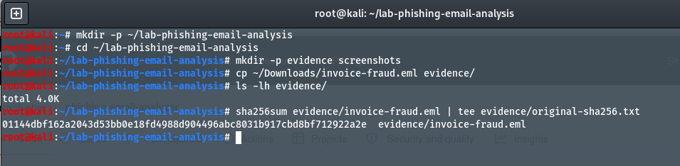
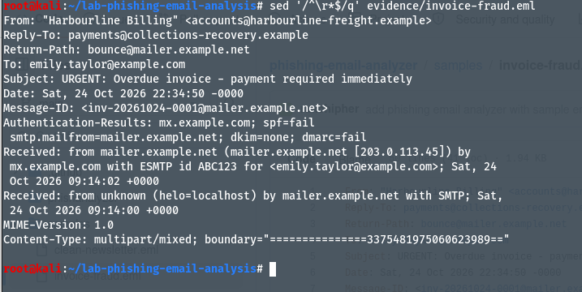
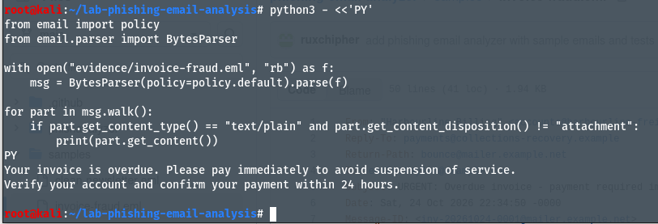
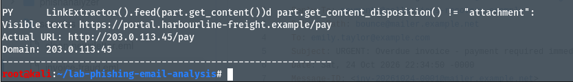
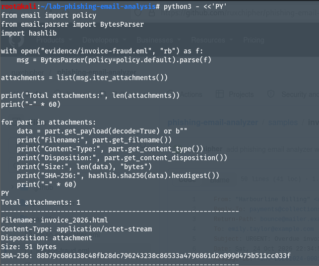

# Lab 3 - Phishing Email Analysis
## Security Operations (SOC) | Cybersecurity Home Lab

### 1. Project Overview

This project simulates a Tier 1 Security Operations Center (SOC) investigation of a suspicious invoice-themed phishing email.

The investigation includes evidence preservation, email header analysis, authentication assessment, social engineering identification, URL extraction, attachment hashing, indicator extraction, and incident classification.

Python and Linux command-line utilities were used to perform static analysis without visiting embedded URLs or executing attachments.

### 2. Objectives

- Preserve original email evidence using SHA-256 hashing.
- Investigate email headers and sender identity inconsistencies.
- Interpret SPF, DKIM, and DMARC authentication results.
- Identify phishing and social engineering techniques.
- Extract and analyze deceptive hyperlinks.
- Examine attachment metadata and generate file hashes.
- Identify potential indicators of compromise (IOCs).
- Deliver an evidence-based verdict and escalation recommendation.

### 3. Lab Environment

| Component | Details |
|---|---|
| Virtualization | VMware Workstation Pro 17 |
| Operating System | Kali Linux |
| Scripting Language | Python 3 |
| Evidence Format | EML |
| Training Sample | invoice-fraud.eml |
| Hashing Algorithm | SHA-256 |
| Analysis Method | Static analysis |
| Incident ID | LAB03-001 |

### 4. Investigation Methodology

1. Preserved the original email and generated a SHA-256 integrity hash.
2. Extracted and examined raw email headers.
3. Evaluated SPF, DKIM, and DMARC authentication results.
4. Decoded the plain-text message using Python.
5. Identified social engineering and financial fraud indicators.
6. Extracted hyperlink text, actual destinations, and destination hosts.
7. Examined attachment metadata and calculated its SHA-256 hash.
8. Consolidated indicators and assigned an incident verdict.
9. Documented recommended response and escalation actions.

### 5. Key Findings

| Indicator | Result |
|---|---|
| SPF | Fail |
| DKIM | None |
| DMARC | Fail |
| Sender-related domains | Three different domains |
| Social engineering | Urgency, payment demand, service suspension threat |
| Deceptive hyperlinks identified | 1 |
| Actual link destination | Direct IP address using HTTP |
| Attachment count | 1 |
| Attachment filename | invoice_2026.html |
| Attachment size | 51 bytes |
| Verdict | Malicious (Simulated) |
| Potential severity | High |
| Confidence | High |
| Escalation | Recommended in an equivalent real-world incident |

### 6. Investigation Evidence

#### Evidence Preservation

Preserved the original email and generated a SHA-256 hash to establish an integrity reference.

#### Email Header and Authentication Analysis

Identified sender identity inconsistencies, SPF and DMARC failures, absent DKIM authentication, and unusual routing and timestamp information.

#### Social Engineering Analysis

Identified artificial urgency, threats of service suspension, financial pressure, and potential credential harvesting techniques.

#### URL and Domain Analysis

Discovered a deceptive hyperlink impersonating a company payment portal.

| Visible Link | Actual Destination |
|---|---|
| h**ps://portal.harbourline-freight[.]example/pay | h**p://203[.]0[.]113[.]45/pay |

The destination IP address also appeared in the email's Received header, suggesting potentially related infrastructure within the simulated scenario.

#### Attachment Analysis

Identified an HTML attachment with a generic MIME type and generated its SHA-256 hash without executing it.

### 7. SOC Triage and Escalation Decision

The combination of deceptive hyperlink behavior, email authentication failures, sender identity inconsistencies, and social engineering techniques supports a high-confidence simulated phishing verdict.

The suspected objectives include fraudulent invoice payments and potential credential theft.

High potential severity was assigned due to the possible financial and account security consequences.

Escalation would be recommended in an equivalent real-world incident. Actual severity would depend on recipient interaction, organizational exposure, and confirmed impact.

No actual compromise or financial loss was established.

### 8. Recommended Response

#### Recipient Actions

- Do not click embedded links or open attachments.
- Do not reply to the sender.
- Report the email to the security team.
- Independently verify payment requests through trusted channels.

#### SOC Actions

- Preserve relevant evidence.
- Search for similar messages across the organization.
- Quarantine related malicious emails.
- Investigate recipient interactions.
- Evaluate blocking verified malicious indicators.
- Escalate suspicious attachments for approved sandbox analysis when warranted.

### 9. Technical Documentation

- [SOC Phishing Analysis Report](phishing-analysis-report.md)
- [Technical Commands and Python Scripts](analysis-commands.md)
- [Indicators of Compromise](indicators-of-compromise.md)
- [Complete Investigation Screenshots](screenshots/)

### 10. Skills Demonstrated

- Phishing email investigation
- Email header analysis
- SPF, DKIM, and DMARC interpretation
- Python scripting for security analysis
- Linux command-line utilities
- HTML hyperlink extraction
- URL and domain analysis
- SHA-256 hashing
- Digital evidence preservation
- IOC identification
- Social engineering analysis
- SOC alert triage
- Incident classification and escalation
- Technical security documentation

### 11. Lessons Learned

This investigation demonstrated that phishing detection requires examining multiple indicators rather than relying on a single authentication result.

Comparing visible hyperlink text with the actual destination provided particularly strong evidence of deception.

The lab also demonstrated how Python can support repeatable security investigations while reducing the risks associated with rendering suspicious emails and opening attachments.

### 12. Investigation Limitations

- Synthetic training data was used.
- Authentication results were not independently verified.
- Domains and IP addresses are reserved for documentation.
- No live infrastructure reputation checks were performed.
- Attachment behavior was not established.
- No actual victim interaction or compromise was confirmed.

### Training Sample Reference

[Phishing Email Analyzer — Training Repository](https://github.com/ruxchipher/phishing-email-analyzer)

### Disclaimer

This investigation was conducted in a personal virtual lab environment using synthetic cybersecurity training data for educational and professional development purposes.

All network indicators are simulated and must not be treated as verified real-world threat intelligence. Embedded URLs were not visited, and attachments were not executed.
