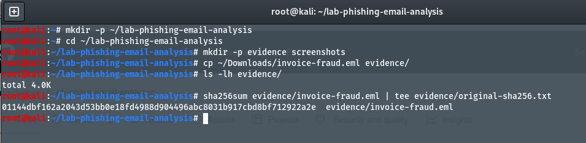
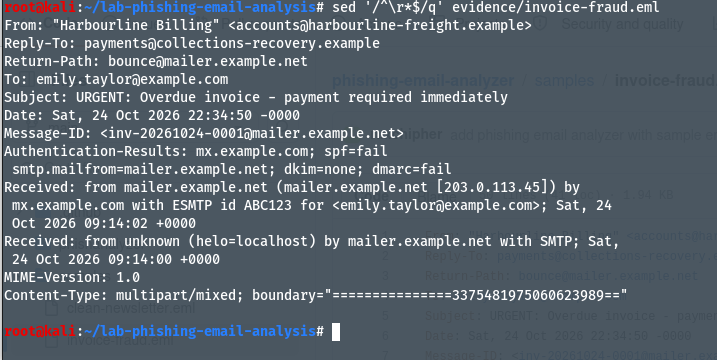
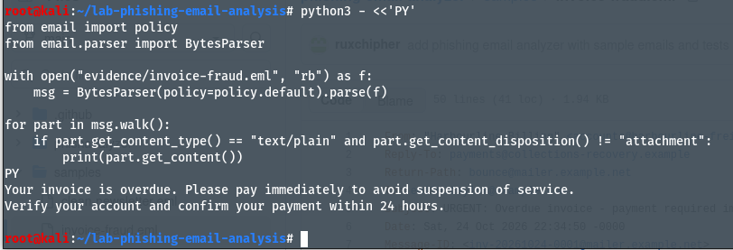
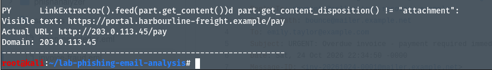
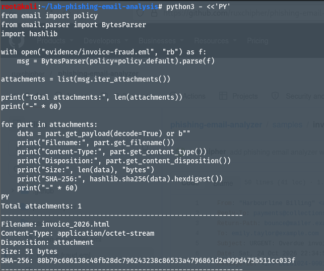

# Phishing Email Analysis - Technical Commands

## Environment

- Operating System: Kali Linux
- Virtualization: VMware Workstation Pro 17
- Scripting Language: Python 3
- Evidence File: invoice-fraud.eml
- Analysis Method: Static email analysis

## 1. Working Directory Preparation

Purpose: Create a dedicated investigation workspace.

```bash
mkdir -p ~/lab-phishing-email-analysis
cd ~/lab-phishing-email-analysis
mkdir -p evidence screenshots
```

## 2. Evidence Preservation

Purpose: Preserve the downloaded email and verify its availability.

```bash
cp ~/Downloads/invoice-fraud.eml evidence/
ls -lh evidence/
```

## 3. SHA-256 Integrity Hash

Purpose: Generate and record the original email's digital fingerprint.

```bash
sha256sum evidence/invoice-fraud.eml | tee evidence/original-sha256.txt
```



## 4. Raw Email Inspection

Purpose: Examine the raw email without rendering its HTML content.

```bash
less evidence/invoice-fraud.eml
```

## 5. Header Extraction

Purpose: Display the main email headers separately from the message body.

```bash
sed '/^\r*$/q' evidence/invoice-fraud.eml
```

Result:

- SPF: Fail
- DKIM: None
- DMARC: Fail
- Three different sender-related domains identified.
- Timestamp inconsistency identified.



## 6. Plain-Text Email Body Extraction

Purpose: Decode and inspect the email's plain-text body without rendering HTML or opening attachments.

```python
from email import policy
from email.parser import BytesParser

with open("evidence/invoice-fraud.eml", "rb") as f:
    msg = BytesParser(policy=policy.default).parse(f)

for part in msg.walk():
    if part.get_content_type() == "text/plain" and part.get_content_disposition() != "attachment":
        print(part.get_content())
```

Result: Identified an overdue invoice claim, immediate payment demand, service suspension threat, and a 24-hour deadline.



## 7. Hyperlink and Domain Extraction

Purpose: Compare visible hyperlink text with its actual destination without establishing a network connection.

```python
from email import policy
from email.parser import BytesParser
from html.parser import HTMLParser
from urllib.parse import urlparse

class LinkExtractor(HTMLParser):
    def __init__(self):
        super().__init__()
        self.url = None
        self.label = ""

    def handle_starttag(self, tag, attrs):
        if tag == "a":
            self.url = dict(attrs).get("href")
            self.label = ""

    def handle_data(self, data):
        if self.url is not None:
            self.label += data

    def handle_endtag(self, tag):
        if tag == "a" and self.url is not None:
            print("Visible text:", self.label.strip())
            print("Actual URL:", self.url)
            print("Domain:", urlparse(self.url).hostname)
            print("-" * 60)
            self.url = None

with open("evidence/invoice-fraud.eml", "rb") as f:
    msg = BytesParser(policy=policy.default).parse(f)

for part in msg.walk():
    if part.get_content_type() == "text/html" and part.get_content_disposition() != "attachment":
        LinkExtractor().feed(part.get_content())
```

Result:

- Visible text: h**ps://portal.harbourline-freight[.]example/pay
- Actual URL: h**p://203[.]0[.]113[.]45/pay
- Destination host: 203[.]0[.]113[.]45

A deceptive hyperlink was identified.

The displayed URLs have been defanged for publication.



## 8. Attachment Metadata and Hash Extraction

Purpose: Identify attachment characteristics and calculate its SHA-256 hash without executing it.

```python
from email import policy
from email.parser import BytesParser
import hashlib

with open("evidence/invoice-fraud.eml", "rb") as f:
    msg = BytesParser(policy=policy.default).parse(f)

attachments = list(msg.iter_attachments())

print("Total attachments:", len(attachments))
print("-" * 60)

for part in attachments:
    data = part.get_payload(decode=True) or b""
    print("Filename:", part.get_filename())
    print("Content-Type:", part.get_content_type())
    print("Disposition:", part.get_content_disposition())
    print("Size:", len(data), "bytes")
    print("SHA-256:", hashlib.sha256(data).hexdigest())
    print("-" * 60)
```

Result:

| Attribute | Value |
|---|---|
| Attachment Count | 1 |
| Filename | invoice_2026.html |
| Content-Type | application/octet-stream |
| Disposition | attachment |
| Size | 51 bytes |
| SHA-256 | 88b79c686138c48fb28dc796243238c86533a4796861d2e099d475b511cc033f |



## 9. Python Modules Used

| Module | Purpose |
|---|---|
| email.policy | Configure email parsing behavior |
| email.parser | Parse raw EML files |
| html.parser | Extract HTML hyperlink information |
| urllib.parse | Identify URL destination hosts |
| hashlib | Generate cryptographic hashes |

## 10. Safety Controls

- Original evidence preserved.
- Email inspected as raw text.
- HTML parsed without browser rendering.
- Embedded URLs were not visited.
- Attachment was not executed.
- No original email or attachment published in this repository.

## 11. Sample Reference

Training sample: invoice-fraud.eml

Source: https://github.com/ruxchipher/phishing-email-analyzer

The commands and Python snippets documented here were used to conduct the static analysis of the training sample.
