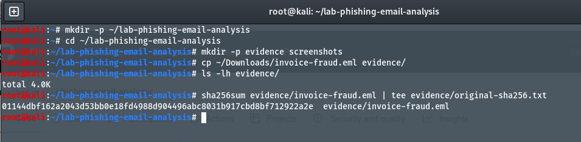
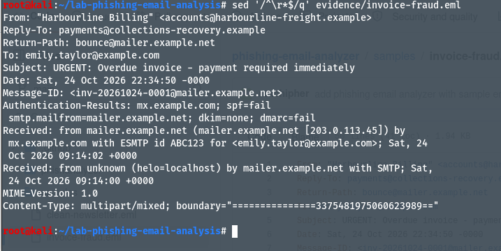
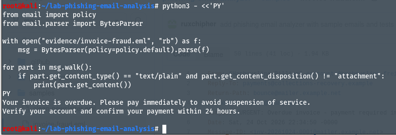
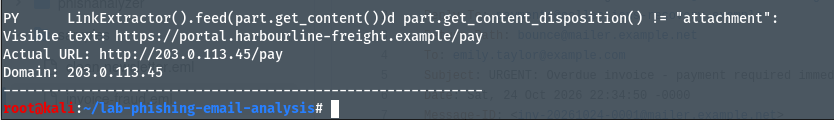
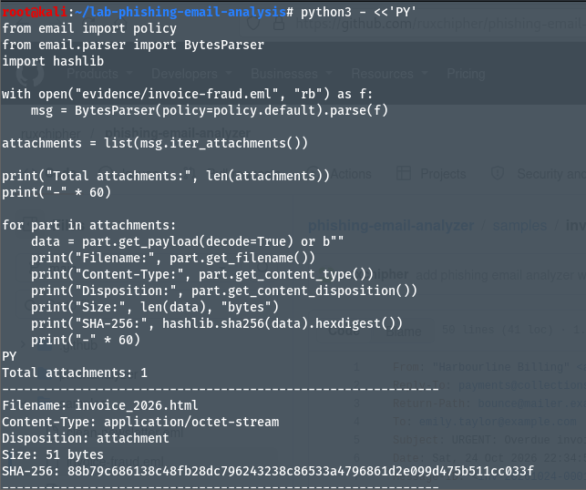

# SOC Phishing Email Investigation Report

## 1. Incident Overview

| Field | Details |
|---|---|
| Incident ID | LAB03-001 |
| Incident Title | Invoice Payment Phishing Investigation |
| Analyst Role | Tier 1 SOC Analyst (Simulated) |
| Evidence Source | Synthetic phishing training sample |
| Original Filename | invoice-fraud.eml |
| Email Date | October 24, 2026 |
| Classification | Invoice Payment Phishing |
| Verdict | Malicious (Simulated) |
| Potential Severity | High |
| Confidence | High |
| Escalation | Recommended in an equivalent real-world incident |

## 2. Executive Summary

A suspicious invoice-themed email was investigated using Kali Linux, Python, and command-line utilities.

The investigation identified email authentication failures, sender identity inconsistencies, social engineering techniques, a deceptive payment hyperlink, and a suspicious HTML attachment.

The combined evidence supports a simulated phishing verdict with potential financial fraud and credential theft objectives.

No actual compromise, credential disclosure, or financial loss was established.

## 3. Evidence Preservation

The original EML file was preserved in a dedicated evidence directory. A SHA-256 hash was generated to establish an integrity reference.

The investigation was conducted without visiting embedded URLs or executing attachments.

## 4. Email Header Analysis

| Header | Observed Value |
|---|---|
| Display Name | Harbourline Billing |
| From | accounts@harbourline-freight[.]example |
| Reply-To | payments@collections-recovery[.]example |
| Return-Path | bounce@mailer[.]example[.]net |
| Subject | URGENT: Overdue invoice – payment required immediately |
| Sending Server IP Shown | 203[.]0[.]113[.]45 |
| SPF | Fail |
| DKIM | None |
| DMARC | Fail |
| Content-Type | multipart/mixed |

The claimed sender, Reply-To, and Return-Path use three different domains.

The supplied authentication results indicate that SPF authorization failed, DKIM authentication was absent, and DMARC requirements were not satisfied.

The message also contains a timestamp inconsistency between the Date and Received headers.

These findings raise suspicion of sender impersonation.

## 5. Social Engineering Analysis

The message instructs the recipient to pay an overdue invoice immediately, threatens service suspension, and requests account verification and payment confirmation within 24 hours.

Identified techniques:

- Artificial urgency.
- Fear of service suspension.
- Financial pressure.
- Potential credential harvesting.
- Generic messaging.
- Lack of supporting invoice details in the plain-text body.

The suspected objective is to pressure the recipient into making a payment or disclosing sensitive account information without independently verifying the request.

## 6. URL and Domain Analysis

| Visible Link | Actual Destination |
|---|---|
| h**ps://portal.harbourline-freight[.]example/pay | h**p://203[.]0[.]113[.]45/pay |

The displayed hyperlink impersonates a company payment portal, while its actual destination is a direct IP address using HTTP.

The destination IP also appears in the email's Received header, suggesting potentially related infrastructure within the simulated scenario.

No URLs were visited during the investigation.

## 7. Attachment Analysis

| Attribute | Observed Value |
|---|---|
| Attachment Count | 1 |
| Filename | invoice_2026.html |
| MIME Type | application/octet-stream |
| Disposition | attachment |
| Decoded Size | 51 bytes |
| SHA-256 | 88b79c686138c48fb28dc796243238c86533a4796861d2e099d475b511cc033f |

The HTML extension, generic MIME type, invoice-themed filename, and small file size warrant further investigation.

HTML attachments may contain deceptive forms, redirects, or executable browser scripts. However, the attachment's actual behavior was not established.

The attachment was hashed in memory without being launched or executed.

## 8. Evidence Ranking

| Rank | Finding | Evidence Strength |
|---|---|---|
| 1 | Deceptive hyperlink destination | Strong |
| 2 | SPF and DMARC failures | Strong |
| 3 | Sender and Reply-To domain mismatch | Supporting |
| 4 | Shared IP in mail routing and payment URL | Supporting |
| 5 | Suspicious HTML attachment | Supporting |
| 6 | Urgency and service suspension threats | Supporting |
| 7 | Timestamp inconsistency | Additional |

## 9. Potential Business Impact

If an equivalent phishing attempt succeeded in a real environment, potential consequences could include:

- Fraudulent invoice payments.
- Credential theft.
- Unauthorized account access.
- Exposure to malicious attachment content.
- Financial and reputational damage.

## 10. Recommended Actions

### Recipient Actions

- Do not click embedded links.
- Do not open the attachment.
- Do not reply to the sender.
- Report the message to the security team.
- Independently verify the invoice through trusted contact information.

### SOC Actions

- Preserve the original message and relevant evidence.
- Search for similar emails across the organization.
- Quarantine matching malicious messages.
- Investigate whether recipients interacted with the email.
- Evaluate blocking verified malicious indicators.
- Escalate the attachment for approved sandbox analysis if warranted.
- Document findings and communicate remediation recommendations.

## 11. Escalation Decision

The combined evidence supports escalation in an equivalent real-world SOC environment.

High potential severity is assigned based on the possible financial and account security consequences. Actual incident severity would depend on recipient interaction, organizational exposure, and confirmed impact.

## 12. Investigation Limitations

- The investigation used a synthetic training email.
- Authentication results were supplied within the sample and were not independently verified.
- The domains and IP address are reserved for documentation purposes.
- No live infrastructure reputation checks were performed.
- Attachment behavior was not verified.
- No actual victim interaction or compromise was established.

## 13. Conclusion

The investigation supports a high-confidence simulated phishing verdict based on deceptive hyperlink behavior, authentication failures, sender inconsistencies, and social engineering techniques.

This project demonstrates structured SOC phishing triage, evidence preservation, indicator extraction, risk assessment, and escalation decision-making.
